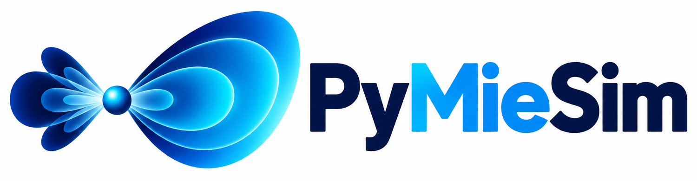
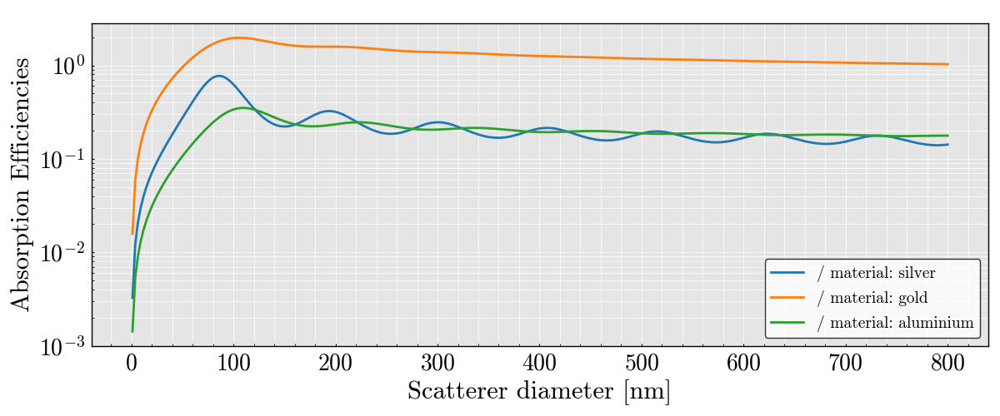

PyMieSim
========

.. list-table::
   :width: 100%
   :widths: 35 65
   :header-rows: 1

   * - Badge
     - Status
   * - Python versions
     - |mps-python|
   * - Documentation
     - |mps-docs|
   * - Tests
     - |mps-ci| |mps-coverage|
   * - PyPI
     - |mps-pypi| |mps-downloads|
   * - Conda
     - |mps-conda| |mps-conda-downloads| |mps-conda-release|

A package for light scattering (Mie) computation.

Calculate scattering by spheres, coated spheres, and cylinders. Specify the incident
field, particle geometry, and optical material, then sweep one input to see how
scattering efficiency or detector coupling changes.

See the `usage guide <https://github.com/MartinPdeS/PyMieSim/blob/HEAD/USAGE.rst>`__ for further examples and implementation details.
Open the `project notebook in Colab <https://colab.research.google.com/github/MartinPdeS/PyMieSim/blob/master/notebook.ipynb>`__.

Installation
------------

Requires Python ``>=3.10``.

.. code-block:: console

   $ python -m pip install PyMieSim

Install from the ``martinpdes`` Conda channel:

.. code-block:: console

   $ conda install -c martinpdes pymiesim

For an editable source installation:

.. code-block:: console

   $ git clone https://github.com/MartinPdeS/PyMieSim.git
   $ cd PyMieSim
   $ python -m pip install -e .

Sweep sphere diameter
---------------------

.. code-block:: python

   """
   Sphere: Qsca vs diameter
   ========================

   """

   import PyOptik
   from PyMieSim import from_pyoptik
   import numpy as np

   from PyMieSim import (
       Measure,
       ureg,
       SphereSet,
       GaussianSet,
       PolarizationSet,
       MaterialSet,
       MediumSet,
       Experiment,
   )

   polarization_set = PolarizationSet(
       angles=[0.0] * ureg.degree,
   )

   source = GaussianSet(
       wavelength=[405] * ureg.nanometer,
       polarization=polarization_set,
       optical_power=[1e-3] * ureg.watt,
       numerical_aperture=[0.2],
   )

   bk7 = from_pyoptik(PyOptik.load_material(name="specs/SCHOTT-optical/P-BK7"))

   scatterer = SphereSet(
       diameter=np.linspace(10, 1000, 150) * ureg.nanometer,
       material=MaterialSet(materials=[bk7]),
       medium=MediumSet(refractive_indices=[1.33, 1.34, 1.5]),
   )

   experiment = Experiment(scatterer_set=scatterer, source_set=source)

   result = experiment.run(Measure.QSCA)

   print("Result dimensions and shape:", result.dims, result.shape)
   print("Measure units:", result.units)

   result.plot(x="scatterer:diameter", show=True)

   Scattering efficiency as a function of sphere diameter.

Documentation
-------------

Use the `PyMieSim documentation <https://martinpdes.github.io/PyMieSim/>`__ to work through
examples and look up the inputs and return values of individual functions.

Citation
--------

For the scattering model and its validation, cite the `PyMieSim paper in Optics Continuum <https://doi.org/10.1364/OPTCON.473102>`__.

Contributing
------------

Bug reports, worked examples, and documentation corrections are welcome.
To set up a development checkout and run the tests, follow the `contributing guide <https://github.com/MartinPdeS/PyMieSim/blob/HEAD/CONTRIBUTING.md>`__.

Contact
-------

For questions, contact `Martin Poinsinet de Sivry-Houle <mailto:martin.poinsinet.de.sivry@gmail.com?subject=PyMieSim>`__.

License
-------

See the `PyMieSim license <https://github.com/MartinPdeS/PyMieSim/blob/HEAD/LICENSE>`__ for terms of use.

.. |mps-python| image:: https://img.shields.io/pypi/pyversions/pymiesim.svg
   :alt: Supported Python versions
   :target: https://pypi.org/project/pymiesim/

.. |mps-pypi| image:: https://img.shields.io/pypi/v/pymiesim.svg
   :alt: PyPI version
   :target: https://pypi.org/project/pymiesim/

.. |mps-downloads| image:: https://img.shields.io/pypi/dm/pymiesim.svg
   :alt: Monthly PyPI downloads
   :target: https://pypistats.org/packages/pymiesim

.. |mps-docs| image:: https://github.com/MartinPdeS/PyMieSim/actions/workflows/deploy_documentation.yml/badge.svg
   :alt: Documentation
   :target: https://martinpdes.github.io/PyMieSim/

.. |mps-ci| image:: https://github.com/MartinPdeS/PyMieSim/actions/workflows/tests.yml/badge.svg
   :alt: Tests
   :target: https://github.com/MartinPdeS/PyMieSim/actions/workflows/tests.yml

.. |mps-conda| image:: https://anaconda.org/martinpdes/pymiesim/badges/version.svg
   :alt: Anaconda version
   :target: https://anaconda.org/martinpdes/pymiesim

.. |mps-conda-downloads| image:: https://anaconda.org/martinpdes/pymiesim/badges/downloads.svg
   :alt: Anaconda downloads
   :target: https://anaconda.org/martinpdes/pymiesim

.. |mps-conda-release| image:: https://anaconda.org/martinpdes/pymiesim/badges/latest_release_relative_date.svg
   :alt: Latest Anaconda release
   :target: https://anaconda.org/martinpdes/pymiesim
