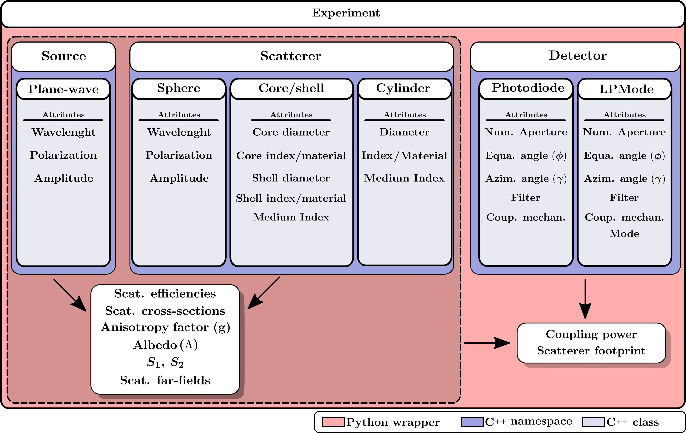

PyMieSim usage guide
====================

First simulation
----------------

Create a source, a scatterer, and a ``Simulation``.  Physical quantities use
the built-in ``ureg`` unit registry, while refractive indices are
dimensionless real or complex values.

.. code-block:: python

    from PyMieSim import (
        Gaussian,
        PolarizationState,
        Simulation,
        Sphere,
        ureg,
    )

    source = Gaussian(
        wavelength=633 * ureg.nanometer,
        polarization=PolarizationState(angle=0 * ureg.degree),
        optical_power=1e-3 * ureg.watt,
        numerical_aperture=0.2,
    )

    scatterer = Sphere(
        diameter=200 * ureg.nanometer,
        material=1.5 + 0.01j,
        medium=1.0,
    )

    simulation = Simulation(scatterer=scatterer, source=source)
    qsca = simulation.run("Qsca")
    print(qsca.quantity)

This prints a dimensionless scattering efficiency, approximately:

.. code-block:: text

   0.2080989068292113 dimensionless

Inspect the measures supported by the configured simulation with:

.. code-block:: python

   print(simulation.available_measures)

For explicit measure and unit metadata, request a typed result:

.. code-block:: python

   result = simulation.run("Qsca")
   print(result.measure, result.quantity, result.units)

Units and material conventions
------------------------------

Always attach units to wavelengths, lengths, powers, and angles:

.. code-block:: python

   633 * ureg.nanometer
   200 * ureg.nanometer
   1e-3 * ureg.watt
   0 * ureg.degree

Refractive indices are dimensionless.  A complex index such as
``1.5 + 0.01j`` represents an absorbing material under PyMieSim's optical
convention.  Built-in and tabulated materials have supported wavelength
ranges; use ``load_material`` and ``validate_wavelength`` when working with
real material data.

Parameter sweeps
----------------

Use ``Experiment`` when you want to evaluate several wavelengths, particle
sizes, or material parameters.  Results retain named dimensions and
coordinates, and can be converted to NumPy or pandas explicitly.

.. code-block:: python

   import numpy as np
   from PyMieSim import (
       Experiment,
       GaussianSet,
       PolarizationSet,
       SphereSet,
       ureg,
   )

   source = GaussianSet(
       wavelength=np.linspace(500, 700, 5) * ureg.nanometer,
       polarization=PolarizationSet(angles=0 * ureg.degree),
       optical_power=1e-3 * ureg.watt,
       numerical_aperture=0.2,
   )
   scatterer = SphereSet(
       diameter=np.linspace(100, 500, 9) * ureg.nanometer,
       material=1.5,
       medium=1.0,
   )

   experiment = Experiment(scatterer_set=scatterer, source_set=source)
   result = experiment.run("Qsca")
   values = result.as_numpy()
   dataframe = result.as_dataframe()

The experiment grid has five wavelength values and nine diameter values, so
``values.shape`` is ``(5, 9)``.  See the
`parameter sweep guide <https://martinpdes.github.io/PyMieSim/workflows/parameter_sweeps.html>`_
for multiple measures and plotting.

Detector coupling
-----------------

Add a detector when you need collected or coupled power rather than only a
scatterer property:

.. code-block:: python

   from PyMieSim import (
       Gaussian,
       Photodiode,
       PolarizationState,
       Simulation,
       Sphere,
       ureg,
   )

   single_source = Gaussian(
       wavelength=633 * ureg.nanometer,
       polarization=PolarizationState(angle=0 * ureg.degree),
       optical_power=1e-3 * ureg.watt,
       numerical_aperture=0.2,
   )
   single_scatterer = Sphere(
       diameter=200 * ureg.nanometer,
       material=1.5 + 0.01j,
       medium=1.0,
   )

   detector = Photodiode(
       sampling=500,
       numerical_aperture=0.2,
       phi_offset=0 * ureg.degree,
       gamma_offset=0 * ureg.degree,
       medium=1.0,
   )
   simulation = Simulation(
       scatterer=single_scatterer,
       source=single_source,
       detector=detector,
   )
   coupling = simulation.run("coupling")
   print(coupling.quantity)

``coupling`` requires a detector.  Other available detector types include
``CoherentMode`` and ``IntegratingSphere``; see the
`detector coupling guide <https://martinpdes.github.io/PyMieSim/workflows/detector_coupling.html>`_.

Common issues
-------------

* If ``import PyMieSim`` fails, run ``python -m pip show PyMieSim`` and check
  that it uses the same Python executable as your script.
* If a constructor reports a unit error, check that every dimensional input
  has units and convert it with ``.to(...)`` when necessary.
* If ``coupling`` is unavailable, add a detector and inspect
  ``simulation.available_measures``.
* For slow or memory-heavy sweeps, print ``experiment.array_shape`` and
  ``experiment.total_iterations`` before requesting a result.
* On servers or in CI, select a non-interactive Matplotlib backend such as
  ``Agg`` before importing plotting code.

See the `online documentation <https://martinpdes.github.io/PyMieSim/>`_ for
theory, performance guidance, runnable examples, and advanced near-field and
far-field workflows.

Code structure
--------------

Here is the architecture for a standard workflow using PyMieSim:

Building from source manually
-----------------------------

The equivalent lower-level workflow is:

.. code-block:: bash

   python -m pip install --no-build-isolation -Cbuild-dir=build -e .

The editable workflow is preferred because it keeps the Python sources and
compiled extensions aligned. A released wheel does not require a compiler or
the native build toolchain.

Citing PyMieSim
---------------

If you use PyMieSim in academic work, please cite:

.. code-block:: text

   @article{PoinsinetdeSivry-Houle:23,
       author = {Martin Poinsinet de Sivry-Houle and Nicolas Godbout and Caroline Boudoux},
       journal = {Opt. Continuum},
       title = {PyMieSim: an open-source library for fast and flexible far-field Mie scattering simulations},
       volume = {2},
       number = {3},
       pages = {520--534},
       year = {2023},
       doi = {10.1364/OPTCON.473102},
   }
