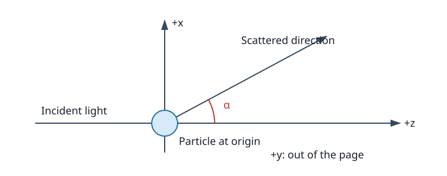

Theory
======

Lorenz-Mie Theory (LMT)
-----------------------

.. note::

  **Lorenz-Mie Theory** (LMT) provides the exact solution for the scattering of a plane wave by a spherical or cylindrical scatterer. The solution is expressed as an infinite summation, which is truncated in practical applications. PyMieSim solves these equations to retrieve several key scattering properties, such as scattering efficiencies and far-field intensities.

From theory to constructor arguments
------------------------------------

For a homogeneous sphere in a real-index surrounding medium, use:

.. list-table:: Symbols and public API
   :header-rows: 1
   :widths: 22 38 40

   * - Symbol
     - Meaning
     - API argument or output
   * - :math:`\lambda_0`
     - Vacuum wavelength, with length units
     - ``PlaneWave(wavelength=...)`` or ``Gaussian(wavelength=...)``
   * - :math:`d=2r`
     - Sphere diameter, with length units
     - ``Sphere(diameter=...)``
   * - :math:`n_p`
     - Particle refractive index, possibly complex
     - ``Sphere(material=...)``; a number or material model
   * - :math:`n_m`
     - Surrounding medium refractive index
     - ``Sphere(medium=...)``
   * - :math:`M=n_p/n_m`
     - Relative index used by the Mie coefficients
     - Computed from ``material`` and ``medium``; supply absolute indices
   * - :math:`x=\pi d n_m/\lambda_0`
     - Size parameter, dimensionless
     - ``simulation.run(Measure.SIZE_PARAMETER)``
   * - :math:`A=\pi d^2/4`
     - Projected sphere area
     - ``simulation.run(Measure.CROSS_SECTION)``

The wavelength in the coefficient equations below is the **medium wavelength**
:math:`\lambda=\lambda_0/n_m`. Pass the vacuum wavelength to the API; do not
rescale it yourself. Material models are also evaluated at the vacuum wavelength.
For core-shell particles, distinguish core diameter from shell thickness using
the :doc:`constructor reference <code/single>`.

Angles and coordinates
----------------------

   Scattering angle :math:`\alpha` is measured from the incident direction.
   Zero is forward scattering and :math:`\pi` is backward scattering.

``Simulation.get_s1s2(angles=...)`` accepts unit-bearing scattering angles
:math:`\alpha`, for example ``[0, 90, 180] * ureg.degree``. Polarization angle
sets the incident transverse polarization; it is a separate constructor input.

Angular field APIs use ``phi`` and ``theta`` rather than the one-dimensional
scattering angle. In the native ``Spherical`` coordinate conversion,
:math:`\theta` is azimuth in the x-y plane and :math:`\phi` is elevation:

.. math::

   x_c=r\cos\phi\cos\theta,\qquad
   y_c=r\cos\phi\sin\theta,\qquad z_c=r\sin\phi.

Thus the polar angle from positive z is :math:`\alpha=\pi/2-\phi`.
Use the returned mesh for structured field arrays: plotting helpers and
structured meshes can use their own angular layout. Do not substitute a
``get_s1s2`` scattering-angle vector directly for a field mesh coordinate.
Detector ``phi_offset`` and ``gamma_offset`` orient the acceptance cone;
use ``simulation.plot_system()`` to inspect its orientation.

Normalization and physical meaning
----------------------------------

For spheres, efficiencies satisfy :math:`C_i=Q_i A`; ``Qsca`` and ``Qext`` are
not fractions of incident source power and can exceed one. Cross sections
carry area units. Infinite-cylinder cross sections use the backend's cylinder
normalization; do not apply the sphere projected-area formula to them.
``coupling`` is detector-collected power in watts for the configured source.

A plot of field magnitude, squared field magnitude, or a normalized angular
pattern has different units and normalization. In particular, the SPF surface
representation is not automatically a probability density whose solid-angle
integral equals one. The :ref:`phase-function example
<sphx_glr_gallery_interpretation_phase_function_size_regimes.py>` explicitly
normalizes its unpolarized angular intensity by its solid-angle integral,
so its curves have units of inverse steradians. Consult :doc:`measures` for
integrated observables and the relevant API docstring for field units.

Key Relations Governing PyMieSim
--------------------------------

The following are some of the core relations used in PyMieSim to compute the scattered fields and related parameters.

.. math::
   S_1 &= \sum\limits_{n=1}^{n_{\text{max}}} \frac{2n+1}{n(n+1)} \left( a_n \pi_n + b_n \tau_n \right) \\[1.1em]
   S_2 &= \sum\limits_{n=1}^{n_{\text{max}}} \frac{2n+1}{n(n+1)} \left( a_n \tau_n + b_n \pi_n \right) \\[1.1em]
   \text{Fields} &= E_{\theta}(\phi, \theta) \hat{\theta} + E_{\phi}(\phi, \theta) \hat{\phi} \\[1.1em]
   \text{SPF} &= \sqrt{|E_{\parallel}(\phi, \theta)|^2 + |E_{\perp}(\phi, \theta)|^2}

**Stokes Parameters:**

These parameters describe the polarization state of the scattered light:

.. math::
   I &= |E_x|^2 + |E_y|^2 \\[1.1em]
   Q &= |E_x|^2 - |E_y|^2 \\[1.1em]
   U &= 2 \operatorname{Re}(E_x E_y^*) \\[1.1em]
   V &= 2 \operatorname{Im}(E_x E_y^*)

Scattering Properties
---------------------

Several important properties of the scatterer can be computed using PyMieSim. These include:

- Scattering efficiency
- Extinction efficiency
- Absorption efficiency
- Back-scattering efficiency
- Forward-to-back scattering ratio
- Radiation pressure efficiency
- Anisotropy factor :math:`g`

These properties are computed as follows:

.. math::
   &Q_{\text{sca}} = \frac{2}{x^2} \sum_{n=1}^{n_{\text{max}}} (2n+1)(|a_n|^2 + |b_n|^2) \\[1.1em]
   &Q_{\text{ext}} = \frac{2}{x^2} \sum_{n=1}^{n_{\text{max}}} (2n+1) \operatorname{Re}(a_n + b_n) \\[1.1em]
   &Q_{\text{abs}} = Q_{\text{ext}} - Q_{\text{sca}} \\[1.1em]
   &Q_{\text{back}} = \frac{1}{x^2} \left| \sum_{n=1}^{n_{\text{max}}} (2n+1)(-1)^n (a_n - b_n) \right|^2 \\[1.1em]
   &Q_{\text{ratio}} = \frac{Q_{\text{back}}}{Q_{\text{sca}}} \\[1.1em]
   &Q_{\text{pr}} = Q_{\text{ext}} - g \cdot Q_{\text{sca}} \\[1.1em]
   &g = \frac{4}{Q_{\text{sca}} x^2} \left[ \sum_{n=1}^{n_{\text{max}}} \frac{n(n+2)}{n+1} \operatorname{Re}(a_n a_{n+1}^* + b_n b_{n+1}^*) + \sum_{n=1}^{n_{\text{max}}} \frac{2n+1}{n(n+1)} \operatorname{Re}(a_n b_n^*) \right]

The cross-sectional areas can be computed as:

.. math::
   A_s &= \pi r^2 \\[1.1em]
   \sigma_i &= Q_i A_s

Where:
- :math:`r` is the sphere radius and :math:`A_s` its projected area.
- :math:`\sigma_{\text{sca}}`, :math:`\sigma_{\text{ext}}`, and :math:`\sigma_{\text{abs}}` are the scattering, extinction, and absorption cross-sections, respectively.

An and Bn Coefficients
----------------------

The Lorenz-Mie theory also defines the coefficients :math:`a_n` and :math:`b_n`, which characterize the scattered fields. These coefficients vary depending on the scatterer's geometry.

Sphere
******

For a spherical scatterer, the :math:`a_n` and :math:`b_n` coefficients are given by:

.. math::
   a_n &= \frac{\mu_{\text{sp}} \Psi_n(x) \Psi_n'(Mx) - \mu M \Psi_n'(x) \Psi_n(Mx)}{\mu_{\text{sp}} \xi_n(x) \Psi_n'(Mx) - \mu M \xi_n'(x) \Psi_n(Mx)} \\[1.1em]
   b_n &= \frac{\mu M \Psi_n(x) \Psi_n'(Mx) - \mu_{\text{sp}} \Psi_n'(x) \Psi_n(Mx)}{\mu M \xi_n(x) \Psi_n'(Mx) - \mu_{\text{sp}} \xi_n'(x) \Psi_n(Mx)}

With:

- :math:`\psi_n` and :math:`\xi_n` being spherical Bessel and Hankel functions.
- :math:`M = \frac{k_{\text{sp}}}{k}` is the relative complex refractive index.
- :math:`x = \frac{\pi d}{\lambda}` is the size parameter.
- :math:`\lambda` is the wavelength in the surrounding medium.

**Note**: PyMieSim assumes :math:`\mu_{\text{sp}} = \mu` for now, but this may change in future updates.

Cylinder
********

For cylindrical scatterers, the coefficients are:

.. math::
   a_n &= \frac{M J_n(Mx) J_n'(mx) - m J_n'(Mx) J_n(mx)}{m J_n(Mx) H_n'(mx) - m J_n'(Mx) H_n(mx)} \\[1.1em]
   b_n &= \frac{m J_n(Mx) J_n'(mx) - M J_n'(Mx) J_n(mx)}{M J_n(Mx) H_n'(mx) - m J_n'(Mx) H_n(mx)}

Where:
- :math:`M` is the refractive index of the scatterer.
- :math:`m` is the refractive index of the medium.
- :math:`H_n` is the Hankel function of the first kind of order :math:`n`.

Core/Shell Sphere
*****************

For core/shell spheres, the coefficients :math:`a_n` and :math:`b_n` are given by more complex expressions:

.. math::
   a_n = \frac{\psi_n [\psi_n'(m_2 y) - A_n \chi_n'(m_2 y)] - m_2 \psi_n'(y) [\psi_n(m_2 y) - A_n \chi_n(m_2 y)]}{\xi_n(y) [\psi_n'(m_2 y) - A_n \chi_n'(m_2 y)] - m_2 \xi_n'(y) [\psi_n(m_2 y) - A_n \chi_n(m_2 y)]}

With:
- :math:`x = \frac{2\pi R_{\text{core}}}{\lambda}` and :math:`y = \frac{2\pi R_{\text{shell}}}{\lambda}`
- :math:`m_1 = \frac{n_{\text{core}}}{n_{\text{medium}}}` and :math:`m_2 = \frac{n_{\text{shell}}}{n_{\text{medium}}}`

Generalized Lorenz-Mie Theory (GLMT)
------------------------------------

.. note::
  **Coming soon** — Future updates will cover the extension of LMT to more complex scatterers using GLMT.

Coupling Mechanisms
-------------------

There are two main coupling mechanisms for light collection: **coherent coupling** and **non-coherent coupling**.

**Coherent coupling** involves interference and usually results in less light being collected but offers additional information about the sample. **Non-coherent coupling** collects light without interference and is used by instruments like photodiodes.

The mathematical definitions are:

.. math::
   C_{\text{coh}} &= \left| \iint_{\Omega} \Phi_{\text{det}} \cdot \Psi_{\text{scat}}^* \, d\Omega \right|^2 \\[1.1em]
   C_{\text{non-coh}} &= \iint_{\Omega} \left| \Phi_{\text{det}} \right|^2 \cdot \left| \Psi_{\text{scat}} \right|^2 \, d\Omega

**Centered Coupling** assumes the scatterer is perfectly aligned with the detector. For non-centered scenarios, the footprint of the scatterer is defined by:

.. math::
   \eta_{l,m}(\delta_x, \delta_y) = \left| \mathcal{F}^{-1} \{ \Phi_{\text{det}} \cdot \Psi_{\text{scat}} \} \right|^2

The mean coupling can be calculated as:

.. math::
   \widetilde{\eta}_{l,m} = \langle \eta_{l,m} (\delta_x, \delta_y) \rangle
